# BÁO CÁO TỔNG QUAN DỰ ÁN TOKENSCOPE
> **Môn học:** PRM393 - Lập trình Di động (Mobile Programming)  
> **Giai đoạn:** Lab 3 - Flutter & Firebase Cloud Integration  
> **Phiên bản:** v1.0.0 (Release-Ready)  
> **Ngày cập nhật:** Tháng 11/2026  

---

## 1. Giới thiệu tổng quan (Project Overview)

### 1.1. Bài toán và Mục tiêu sản phẩm
Trong kỷ nguyên GenAI, các lập trình viên và doanh nghiệp thường sử dụng đồng thời nhiều nhà cung cấp mô hình ngôn ngữ lớn (LLM) khác nhau như **OpenAI** (GPT-4o, GPT-3.5), **Google Gemini** (Gemini 2.5 Flash, Gemini Pro), **Anthropic** (Claude 3.5 Sonnet)... Việc phân tán này gây ra khó khăn lớn trong việc:
* Kiểm soát ngân sách và cảnh báo khi sắp vượt hạn mức.
* Theo dõi số lượng Token tiêu thụ (Input / Output Tokens) theo thời gian thực.
* Truy vết lịch sử các cuộc gọi API, mã lỗi (HTTP Status) và độ trễ phản hồi (Latency).

**TokenScope** là ứng dụng di động đa nền tảng (Flutter) kết hợp đám mây (Firebase & Node.js Backend) giải quyết triệt để bài toán trên, đóng vai trò là bảng điều khiển tập trung giúp quản lý toàn diện hạn mức chi tiêu, kết nối API Key an toàn và xuất báo cáo kiểm toán chi phí.

---

## 2. Kiến trúc hệ thống (System Architecture)

Dự án áp dụng chặt chẽ mô hình **MVVM (Model - View - ViewModel)** kết hợp thư viện quản lý trạng thái `Provider/ChangeNotifier` theo chuẩn yêu cầu Slide 4 của Lab 3:

```mermaid
flowchart LR
    subgraph UI_Layer ["Giao diện (View)"]
        V1["Screens (Dashboard, History, Settings...)"]
        V2["Widgets Tái sử dụng (TsCard, TsButton...)"]
    end

    subgraph VM_Layer ["Trạng thái (ViewModel)"]
        VM1["AuthController"]
        VM2["DashboardController"]
        VM3["UsageHistoryController"]
        VM4["BudgetController"]
        VM5["ProvidersController"]
    end

    subgraph Service_Layer ["Nghiệp vụ (Service Layer)"]
        S1["ApiAuthService / ApiClient"]
        S2["ProviderService / UsageService"]
        S3["Firebase Storage Service"]
        S4["Firebase Messaging Service"]
        S5["Firebase Crashlytics Service"]
        S6["Firebase Remote Config Service"]
        S7["Firebase Analytics Service"]
    end

    subgraph External_Layer ["Nền tảng Đám mây & Backend"]
        BE["Node.js / Express / Prisma / SQL Server"]
        FB["Firebase Services (Auth, Storage, FCM, Analytics, Crashlytics, RC)"]
    end

    UI_Layer --> VM_Layer
    VM_Layer --> Service_Layer
    Service_Layer --> External_Layer
```



* **Nguyên tắc ranh giới:** Giao diện (`View`) tuyệt đối không gọi trực tiếp Firebase SDK hoặc gọi thẳng HTTP API, mà luôn thông qua `Controller/ViewModel` và các lớp `Service`.
* **Trạng thái giao diện:** Xử lý tường minh 4 trạng thái: Đang tải (`isLoading`), Có dữ liệu (`hasData`), Rỗng (`isEmpty`), và Lỗi (`hasError`).

---

## 3. Cấu trúc thư mục mã nguồn (Codebase Structure)

```text
F:\PRM\
├── BE_tokenScope/                  # Backend Node.js / Express
│   ├── prisma/
│   │   └── schema.prisma           # Định nghĩa cấu trúc Database (Users, Providers, Usages, Budgets)
│   ├── src/
│   │   ├── controllers/            # Bộ xử lý yêu cầu HTTP API
│   │   ├── routes/                 # Định tuyến API (/api/auth, /api/providers, /api/budgets...)
│   │   ├── middlewares/            # Xác thực JWT, phân quyền
│   │   └── services/               # Logic nghiệp vụ & gọi API LLM đo lường token
│   └── .env                        # Biến môi trường, chuỗi kết nối SQL Server, JWT Secrets
│
├── FE_tokenScope/                  # Frontend ứng dụng Flutter
│   ├── android/                    # Cấu hình Native Android (Gradle 9, KGP, Permissions)
│   │   └── app/
│   │       ├── build.gradle.kts    # Cấu hình plugin Crashlytics, Google Services
│   │       ├── google-services.json# Tệp cấu hình dự án Firebase
│   │       └── src/main/AndroidManifest.xml # Khai báo quyền INTERNET, POST_NOTIFICATIONS
│   ├── firebase/
│   │   └── storage.rules           # Quy tắc bảo mật phân quyền Cloud Storage theo UID
│   ├── docs/
│   │   ├── analytics-plan.md       # Kế hoạch đo lường 7 sự kiện bắt buộc của Firebase Analytics
│   │   └── PROJECT_SUMMARY.md      # Báo cáo tổng quan dự án
│   ├── lib/
│   │   ├── core/                   # Design System: Bảng màu (AppColors), Typography, Spacing, Widgets
│   │   ├── models/                 # Mô hình dữ liệu (User, UsageRecord, Budget, InAppNotification...)
│   │   ├── providers/              # Lớp ViewModel (AuthController, UsageHistoryController...)
│   │   ├── screens/                # Màn hình giao diện (Auth, Dashboard, Alerts, History, Budget...)
│   │   ├── services/               # Tích hợp Firebase SDKs & HTTP Backend Services
│   │   ├── firebase_options.dart   # Cấu hình khởi tạo Firebase đa nền tảng
│   │   └── main.dart               # Điểm khởi chạy ứng dụng & khởi tạo an toàn các dịch vụ đám mây
│   └── test/                       # 101 bài kiểm thử tự động (Unit, Widget, Mock, Integration Tests)
└── PROJECT_SUMMARY.md              # Báo cáo tổng quan dự án ở thư mục gốc
```

---

## 4. Hiện thực 6 Dịch vụ Firebase (Lab 3 Requirements)

Toàn bộ 6 dịch vụ Firebase bắt buộc theo hướng dẫn chuẩn bị Lab 3 đều đã được tích hợp hoàn chỉnh:

| STT | Dịch vụ Firebase | Slide | Thành phần hiện thực | Đặc tả kỹ thuật & Trạng thái |
| :---: | :--- | :---: | :--- | :--- |
| **1** | **Firebase Authentication** | 5–7 | `FirebaseAuthService`, Google Sign-In, Session Persistence | Xác thực Google Sign-In thật, theo dõi `authStateChanges`, hỗ trợ huỷ chọn tài khoản êm dịu, lưu và làm mới phiên làm việc qua JWT. |
| **2** | **Firebase Cloud Storage** | 8–10 | `FirebaseStorageService`, PDF Generator, `storage.rules` | Tạo tệp PDF thống kê chi phí/token thực tế; upload vào `reports/{uid}/...` có thanh tiến độ realtime; bảo vệ phân quyền theo `storage.rules`. Tích hợp chế độ giả lập cục bộ an toàn theo Slide 4. |
| **3** | **Firebase Cloud Messaging (FCM)** | 11–13 | `FirebaseMessagingService`, `AlertsScreen` (Trung tâm thông báo) | Xin quyền Android 13+ (`POST_NOTIFICATIONS`); xử lý 3 trạng thái (Foreground/Background/Terminated); lưu thông báo vào In-app Center; điều hướng khi chạm. |
| **4** | **Google Analytics for Firebase** | 14–16 | `FirebaseAnalyticsService`, `docs/analytics-plan.md` | Định nghĩa chuẩn 7 sự kiện bắt buộc: `login`, `logout`, `connect_provider`, `view_usage_history`, `view_usage_detail`, `export_report`, `update_budget`. Không chứa PII (email/tên); gán `setUserId`. |
| **5** | **Firebase Crashlytics** | 17–19 | `FirebaseCrashlyticsService` | Khởi tạo bắt lỗi Flutter framework (`FlutterError.onError`) & Async (`PlatformDispatcher`); gán `setUserId` + Custom Keys; có nút test lỗi Non-Fatal và nút Fatal Crash phục vụ demo. |
| **6** | **Firebase Remote Config** | 20–22 | `FirebaseRemoteConfigService`, `TsPromoBanner` | Quản lý 4 tham số từ xa (`promo_banner_enabled`, `promo_banner_text`, `max_history_items`, `enable_pdf_export`). Nút Fetch & Activate trên app giúp cập nhật giao diện tức thì từ Firebase Console mà không cần build lại APK. |

---

## 5. Báo cáo Chất lượng & Kiểm thử (Quality Assurance)

Dự án đạt tiêu chuẩn kiểm thử chất lượng cao:

### 5.1. Kiểm tra tĩnh (Static Code Analysis)
* Lệnh: `flutter analyze`
* Kết quả: **`No issues found!`** (0 lỗi, 0 cảnh báo, 0 cảnh báo cú pháp).

### 5.2. Bộ kiểm thử tự động (Automated Test Suite)
* Lệnh: `flutter test`
* Kết quả: **`All 101 tests passed!`** (101/101 bài kiểm thử đạt 100%).
* Danh mục kiểm thử bao gồm:
  - Unit tests cho thuật toán rút gọn tên (`shortName`), phân tích ngày tháng và tính chi phí.
  - Mock tests mô phỏng các trạng thái đăng nhập, huỷ đăng nhập Google.
  - Widget tests kiểm tra cấu trúc giao diện và luồng điều hướng giữa các tab.
  - Golden tests kiểm tra độ tương thích pixel-perfect theo thiết kế Figma.
  - Layout Overflow tests đảm bảo ứng dụng không bao giờ bị tràn giao diện (RenderFlex overflow) trên mọi kích thước màn hình.

### 5.3. Trạng thái Build APK Native Android
* Quá trình biên dịch Gradle Native Android: **`BUILD SUCCESSFUL`** (377 actionable tasks).
* Tệp APK thành phẩm đã sẵn sàng:
  👉 **`FE_tokenScope\build\app\outputs\flutter-apk\app-debug.apk`** (dung lượng ~114 MB).

---

## 6. Hướng dẫn Chạy ứng dụng & Trình diễn Demo (Demo Checklist)

### 6.1. Khởi động hệ thống
1. **Khởi động Backend:**
   ```powershell
   cd F:\PRM\BE_tokenScope
   npm run dev
   ```
2. **Khởi chạy ứng dụng Flutter trên Android Emulator:**
   ```powershell
   cd F:\PRM\FE_tokenScope
   flutter run
   ```

### 6.2. Kịch bản trình diễn chấm điểm Lab 3 (5–10 phút)
1. **Authentication (Slide 7):** Đăng nhập bằng Google hoặc tài khoản `demo@tokenscope.io` / `123456`. Vào tab **Cài đặt** xem UID Firebase duy nhất đã được cấp.
2. **Cloud Storage (Slide 10):** Nhấn **"Xuất PDF & Tải lên Cloud Storage"** $\rightarrow$ Xem thanh tiến độ chạy $0\% \rightarrow 100\%$ và xuất hiện đường link tải báo cáo.
3. **Cloud Messaging (Slide 13):** Bấm biểu tượng **Chuông** trên Dashboard $\rightarrow$ Xem FCM Device Token $\rightarrow$ Bấm **"Tạo thông báo thử"** $\rightarrow$ Chạm vào thông báo để xem tính năng tự động chuyển trang sang màn hình Ngân sách.
4. **Remote Config (Slide 22):** Lên Firebase Console bật `promo_banner_enabled = true` $\rightarrow$ Trên app vào Cài đặt bấm **"Làm mới cấu hình Cloud"** $\rightarrow$ Quay lại Dashboard thấy Banner màu tím xuất hiện ngay lập tức.
5. **Crashlytics (Slide 19):** Bấm **"Gửi lỗi Non-Fatal"** $\rightarrow$ App báo thành công (không văng). Bấm **"Crash thử nghiệm"** $\rightarrow$ App văng thật để gửi log lên Crashlytics Console.
6. **Analytics (Slide 16):** Mở Firebase Console mục **Analytics $\rightarrow$ DebugView** (bật lệnh `adb shell setprop debug.firebase.analytics.app com.tokenscope.tokenscope`) để thấy các sự kiện bắn lên thời gian thực.

---
*Tài liệu được biên soạn phục vụ lưu trữ, thuyết trình và nộp báo cáo Lab 3 PRM393.*
