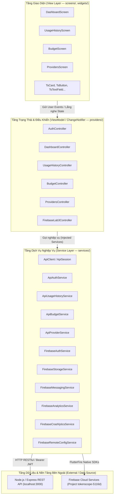
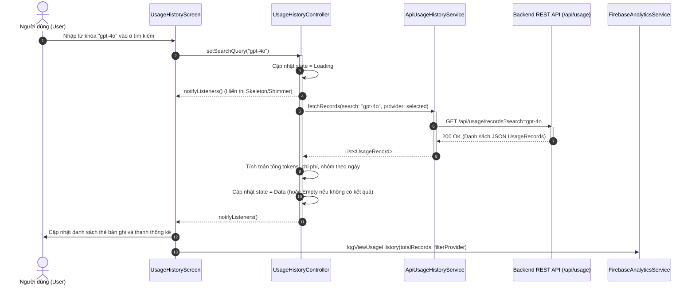

# Đặc Tả Kiến Trúc Ứng Dụng TokenScope (Architecture Specification)
> **Môn học:** PRM393 - Lập trình Di động (Lab 3)  
> **Kiến trúc:** MVVM (Model - View - ViewModel) với Provider/ChangeNotifier  
> **Nguyên tắc ranh giới:** Chiều phụ thuộc luôn đi xuống; không lớp nào được import lớp phía trên nó.

---

## 1. Cấu Trúc Thư Mục Dự Án (Folder Structure — One Line Per Folder)

```text
lib/                                # Thư mục gốc chứa toàn bộ mã nguồn Flutter
lib/core/                           # Hạ tầng lõi dùng chung cho toàn bộ ứng dụng
lib/core/constants/                 # Các hằng số định danh và cấu hình cố định
lib/core/network/                   # Cấu hình kết nối mạng, interceptors và timeout
lib/core/routes/                    # Quản lý định tuyến và ánh xạ tên màn hình
lib/core/theme/                     # Design System: Bảng màu, Typography, Spacing, Bo góc, Độ nổi
lib/core/utils/                     # Tiện ích bổ trợ (chuyển đổi ngày tháng, animation flag)
lib/core/widgets/                   # Thư viện thành phần UI dùng chung (TsButton, TsCard, TsDialog...)
lib/models/                         # Các lớp mô hình dữ liệu (Data Models) không chứa logic nghiệp vụ
lib/providers/                      # Lớp ViewModel (ChangeNotifier) quản lý trạng thái màn hình
lib/screens/                        # Giao diện màn hình (Views) chỉ hiển thị và nhận sự kiện người dùng
lib/screens/alerts/                 # Màn hình Trung tâm Thông báo (Alerts & Push Notifications)
lib/screens/analysis/               # Màn hình Phân tích Chuyên sâu sử dụng AI & Biểu đồ Donut
lib/screens/auth/                   # Các màn hình xác thực: Đăng nhập, Đăng ký, Quên mật khẩu
lib/screens/budget/                 # Màn hình Quản lý Ngân sách AI và dự báo chi tiêu
lib/screens/dashboard/              # Màn hình Bảng điều khiển Tổng quan và các thẻ chỉ số Hero
lib/screens/projects/               # Màn hình Quản lý Dự án và phân bổ môi trường
lib/screens/providers/              # Màn hình Kết nối & Kiểm định khóa Nhà cung cấp AI
lib/screens/usage_details/          # Màn hình Chi tiết kỹ thuật lượt gọi API, Prompt và mã cURL
lib/screens/usage_history/          # Màn hình Lịch sử gọi API kèm bộ lọc và tìm kiếm realtime
lib/services/                       # Lớp dịch vụ nghiệp vụ (HTTP API Client & Firebase SDK Adapters)
```

---

## 2. Sơ Đồ Phân Tầng Kiến Trúc MVVM (Layer Diagram)



### Quy tắc nghiêm ngặt trong phân tầng:
1. **Không widget nào được gọi trực tiếp `http`, `FirebaseAuth.instance`, `FirebaseAnalytics.instance`**: Mọi tương tác mạng và đám mây đều phải thông qua `Service`.
2. **Logic nghiệp vụ không nằm trong hàm `build()`**: Các tác vụ tính toán, gom nhóm, lọc danh sách nằm hoàn toàn trong ViewModel hoặc Service.
3. **Mọi Service đều có thể thay thế (Injected)**: Phục vụ chạy Unit Test với Fake/Mock Services mà không cần mạng.

---

## 3. Sơ Đồ Tuần Tự Cho Luồng Hoàn Chỉnh (Sequence Diagram)
*Ví dụ luồng: Người dùng tìm kiếm lịch sử gọi API $\rightarrow$ ViewModel tải dữ liệu $\rightarrow$ Cập nhật biểu đồ và danh sách.*



---

## 4. Bảng Ma Trận ViewModel và Các Service Được Sử Dụng

| Tên ViewModel (Controller) | Trách nhiệm quản lý trạng thái | Service chính được tiêm (Injected) | Service Firebase hỗ trợ |
|---|---|---|---|
| **`AuthController`** | Quản lý phiên làm việc, đăng ký, đăng nhập, quên MK, thông tin user | `ApiAuthService`, `AuthService` | `FirebaseAuthService` (Google Sign-In) |
| **`DashboardController`** | Quản lý số liệu tổng hợp token, chi phí, nhà cung cấp, biểu đồ tuần | `ApiUsageHistoryService` | `FirebaseRemoteConfigService` (Promo banner) |
| **`UsageHistoryController`** | Quản lý danh sách lịch sử gọi, bộ lọc nhà cung cấp, tìm kiếm từ khóa | `ApiUsageHistoryService` | `FirebaseAnalyticsService` (`view_usage_history`) |
| **`BudgetController`** | Quản lý hạn mức chi phí tháng, dải cảnh báo, dự báo cuối tháng | `ApiBudgetService` | `FirebaseAnalyticsService` (`update_budget`) |
| **`ProvidersController`** | Quản lý danh mục nhà cung cấp, kết nối API Key, test kết nối | `ApiProviderService` | `FirebaseAnalyticsService` (`connect_provider`) |
| **`ProjectsController`** | Quản lý danh sách dự án, môi trường triển khai, tỷ trọng token | `ProjectService` | — |
| **`AnalysisController`** | Quản lý phân tích chuyên sâu: Tỷ lệ Input/Output, Donut chart, Top models | `AnalysisService` | — |
| **`FirebaseLab3Controller`** | Điều phối tập trung 6 dịch vụ Firebase của Lab 3 | — | `FirebaseAuthService`, `FirebaseStorageService`, `FirebaseMessagingService`, `FirebaseAnalyticsService`, `FirebaseCrashlyticsService`, `FirebaseRemoteConfigService` |

---

## 5. Mô Hình Trạng Thái Tường Minh (Explicit State Models)

Mọi màn hình tải dữ liệu trong TokenScope đều cài đặt rõ ràng 4 trạng thái giao diện:

| Trạng thái | Điều kiện kích hoạt | Widget hiển thị |
|---|---|---|
| **Đang tải (`isLoading`)** | Khi bắt đầu gọi API hoặc làm mới dữ liệu | `TsSkeletonCard`, `CircularProgressIndicator` |
| **Có dữ liệu (`hasData`)** | API trả về danh sách có phần tử hợp lệ | Danh sách thẻ `TsCard`, Biểu đồ, Hero card |
| **Rỗng (`isEmpty`)** | Kết quả tìm kiếm/lọc không có bản ghi nào | `TsEmptyState` kèm mô tả và nút "Xóa bộ lọc" |
| **Lỗi (`hasError`)** | Lỗi mạng, mã lỗi 500, lỗi xác thực | `TsErrorState` kèm thông báo tiếng Việt và nút "Thử lại ngay" |
